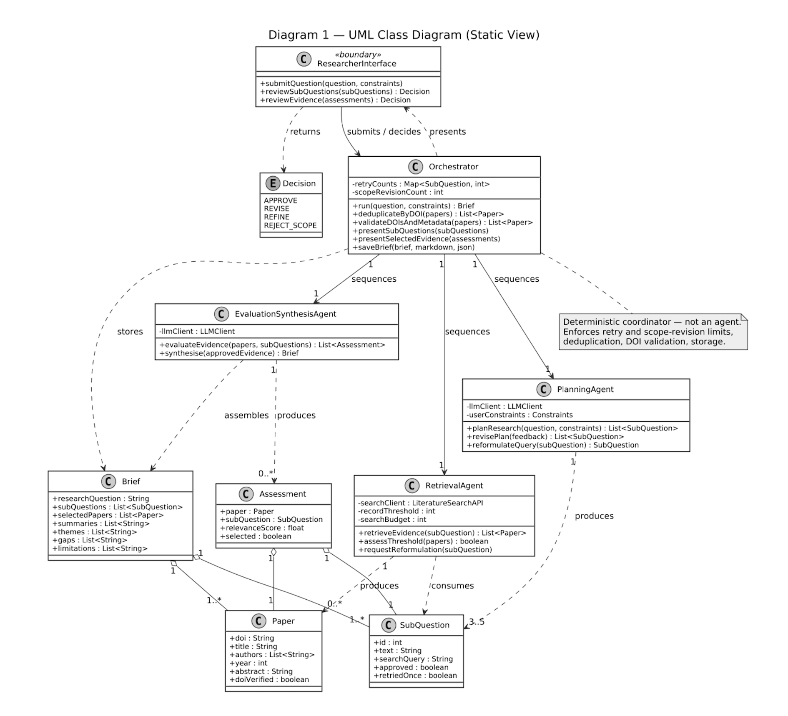

[Home](index.html)

# Team project: the design proposal

## What we proposed

Group D (Lana Menezes Fidelis, Lara Koller, Dragos Hont and me) proposed a research agent for academic literature search. A researcher gives it a question. A Planning Agent breaks the question into sub-questions and search queries, a Retrieval Agent searches a scholarly index, and an Evaluation and Synthesis Agent scores the papers and writes an evidence brief. A deterministic orchestrator, which is not an agent, runs the steps in order, de-duplicates records, checks every DOI against Crossref and saves the brief. The researcher approves the plan before any search and the evidence before any writing.

The report ([PDF](assets/Project_Report_Group_D.pdf)) was submitted on 4 September 2026 (Unit 6) and received 64% (Merit). The full feedback is on the [feedback](feedback.html) page.

## My contribution

My part was the class diagram (Diagram 1), which fixed the names and responsibilities of every class before any code existed. Lara spotted that it was missing the boundary class for the researcher, and the diagram is better for it.

The diagram turned out to be the most useful thing I did for the build. `agents/models.py` in the implemented system holds the data classes from this diagram, and the README lists every place where the build departs from it.

## Team notes

We never held a meeting. Early in the project we agreed on WhatsApp who would take which section, worked on our parts in parallel in a shared Google Drive, and Lara pulled the report together at the end. Lana wrote sections 1 to 3 before the internal deadline and tightened them after review. Dragos took section 5, the risks and mitigations. Lara wrote section 4, Diagrams 2 and 3, and did the final read-through. I drew Diagram 1 and kept up with the chat.

It was quiet, but it worked. The report was complete and consistent and went in on time. The one planning point for the team as a whole is that the final integration was tight, because all of us left it to the last few days.

What I would do differently is small and concrete: a short call at the start and one before the internal deadline, alongside the chat. The report would have been the same. I would have known the people.

## After the proposal

Each of us then had to build the design on our own. Lana, Dragos and Lara, whose posts I answered in the discussions, were building their own versions at the same time. Reading their forum posts in October, after I had built mine, was the closest the team came to a design review. Dragos's test for the difference between a method call and an agent message, and Lara's point about fairness being built in throughout development, both changed how I describe my own system.

## AI acknowledgement

This declaration applies to the whole Intelligent Agents e-portfolio, including this page and all artefact pages it links to. I used generative AI tools (Grammarly and Claude) to proofread, improve wording and help with formatting. The analysis, interpretation, conclusions and recommendations throughout are my own.