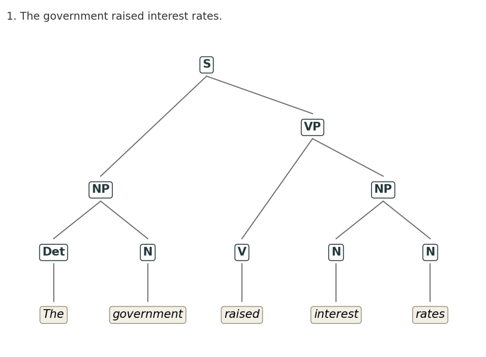
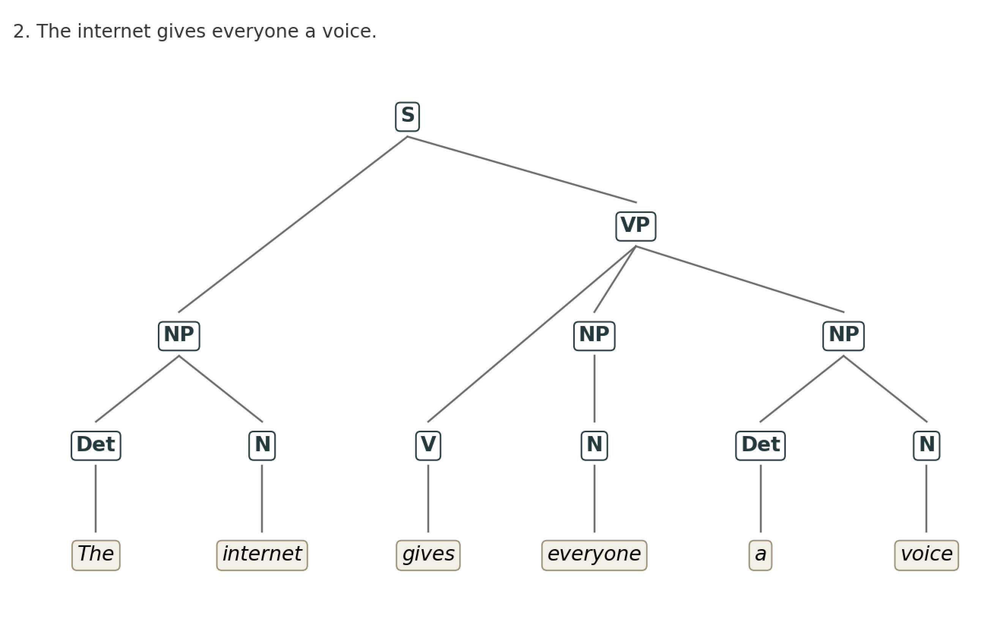
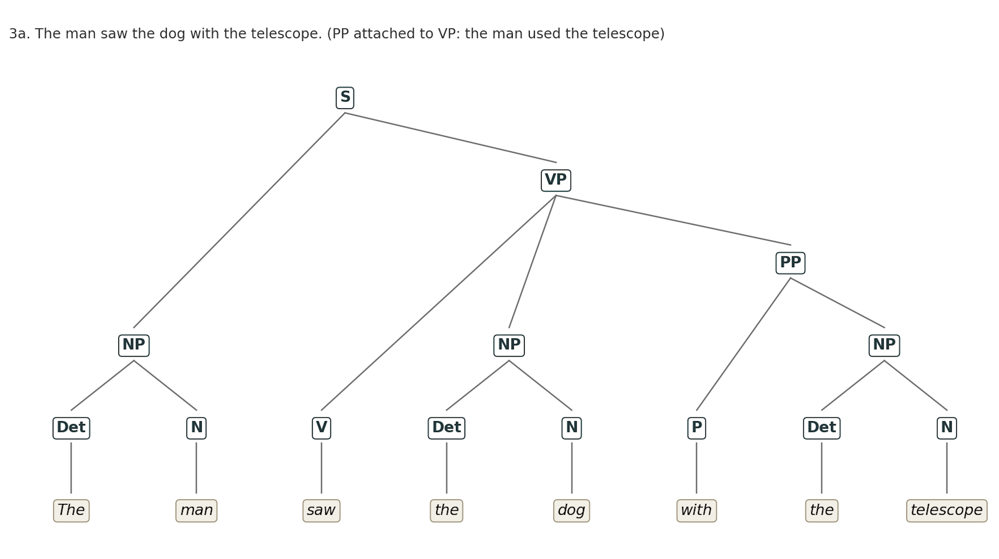
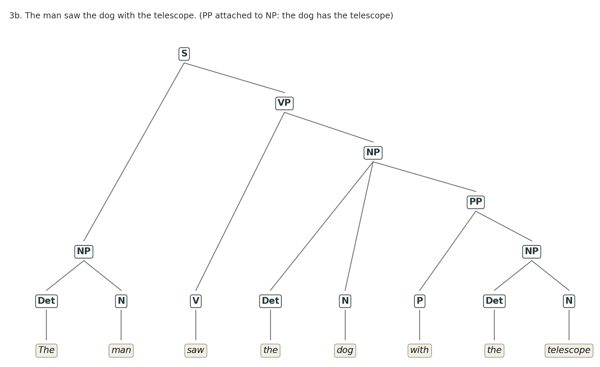

[Home](index.html)

# Unit 8 – Creating Parse Trees

Activity: create a constituency-based parse tree for each of these phrases.

1. The government raised interest rates.
2. The internet gives everyone a voice.
3. The man saw the dog with the telescope.

A constituency parse tree splits a sentence into the groups of words that behave as single units, called constituents (Jurafsky and Martin, 2023). Each tree below has the sentence (S) at the top, the phrases in the middle (NP = noun phrase, VP = verb phrase, PP = prepositional phrase) and the words at the bottom with their parts of speech (Det = determiner, N = noun, V = verb, P = preposition).

## Grammar used

I used a small set of rules of the kind Jurafsky and Martin (2023) use for English, and checked that each tree below follows them.

```
S  -> NP VP
NP -> Det N | N | N N | Det N PP
VP -> V NP | V NP NP | V NP PP
PP -> P NP
```

## 1. The government raised interest rates.



```
(S (NP (Det The) (N government))
   (VP (V raised)
       (NP (N interest) (N rates))))
```

The subject is the noun phrase "The government". The verb phrase is "raised interest rates", where "interest rates" is one noun phrase made of two nouns. "Interest" describes what kind of rates they are, so it belongs inside the object, not next to it.

## 2. The internet gives everyone a voice.



```
(S (NP (Det The) (N internet))
   (VP (V gives)
       (NP (N everyone))
       (NP (Det a) (N voice))))
```

"Gives" takes two objects. "Everyone" is the one who receives, and "a voice" is what is given, so the verb phrase has two noun phrases after the verb. "Everyone" is a pronoun, and I have labelled it N because it fills the whole noun phrase on its own.

## 3. The man saw the dog with the telescope.

This sentence has two correct trees, because the prepositional phrase "with the telescope" can attach to the verb phrase or to the noun phrase "the dog". Jurafsky and Martin (2023) call this structural ambiguity and give the example "I shot an elephant in my pajamas", where the phrase "in my pajamas" can be part of the noun phrase or of the verb phrase.

### 3a. The man used the telescope (PP attached to VP)



```
(S (NP (Det The) (N man))
   (VP (V saw)
       (NP (Det the) (N dog))
       (PP (P with) (NP (Det the) (N telescope)))))
```

### 3b. The dog has the telescope (PP attached to NP)



```
(S (NP (Det The) (N man))
   (VP (V saw)
       (NP (Det the) (N dog)
           (PP (P with) (NP (Det the) (N telescope))))))
```

The words and the parts of speech are the same in both trees. Only the place where the PP attaches changes, and with it the meaning. Nothing in the sentence itself decides between them. A reader uses common sense (people use telescopes, dogs usually do not), and a parser needs either that kind of knowledge or statistics from many parsed sentences.

## What I noticed

The grammar that is needed for sentence 2 causes a problem for sentence 1. Because "gives" needs the rule VP -> V NP NP, the same rule also allows "raised interest rates" to be read as "raised [interest] [rates]", with two separate objects, which is wrong. The rules alone cannot tell that "raise" takes one object and "give" takes two. So even a sentence that looks simple needs information about individual words before the right tree can be chosen.

This connects to the research agent I built for this module. The agent does not parse anything, but it has the same kind of gap. Its JSON schema fixes the shape of every model reply, in the way the grammar fixes the shape of a tree, and it cannot tell whether the content inside the shape is right. For sentence 3 that is the attachment choice. For the agent it is the relevance score the model gives each paper, which is why the researcher reviews the scores before anything is written.

The required reading for this unit, Zimmerman (2019), uses dependency trees rather than constituency trees. In a dependency tree the links run between words and there are no phrase nodes. The attachment ambiguity in sentence 3 shows up there as well, as the question of whether "with" depends on "saw" or on "dog".

## References

Jurafsky, D. and Martin, J.H. (2023) 'Context-free grammars and constituency parsing', in *Speech and language processing*. 3rd edn, draft of 7 January 2023, chapter 17. Available at: https://web.stanford.edu/~jurafsky/slp3/old_jan23/17.pdf (Accessed: 13 October 2026).

Zimmerman, V. (2019) *Getting to grips with parse trees*. Towards Data Science. Available at: https://towardsdatascience.com/getting-to-grips-with-parse-trees-6e19e7cd3c3c/ (Accessed: 13 October 2026).
